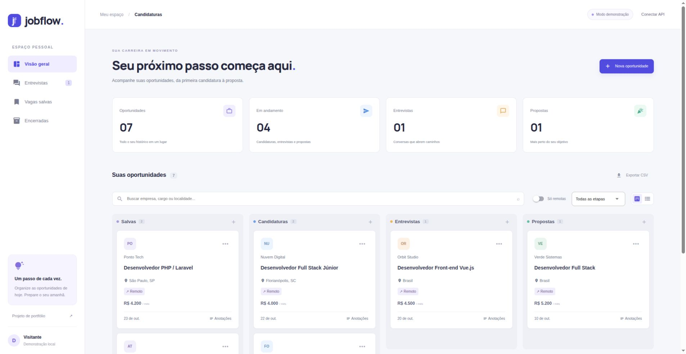
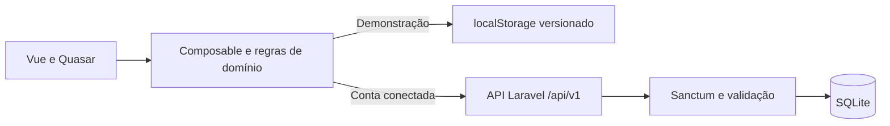

# JobFlow

**Organize suas candidaturas, da primeira oportunidade à proposta.**

Aplicação de portfólio com **Vue 3, Quasar, TypeScript, PHP e Laravel 13**. O quadro permite acompanhar etapas de processos seletivos, registrar anotações e exportar candidaturas.



## O que você pode fazer

- Criar e editar oportunidades com empresa, cargo, localidade, salário, link e próximos passos.
- Mover candidaturas entre salvas, candidaturas, entrevistas, propostas e encerradas.
- Buscar por empresa, cargo e localidade, combinando etapa e modalidade remota.
- Alternar entre quadro e lista e exportar os resultados em CSV.
- Experimentar sem cadastro, com dados fictícios salvos no navegador.
- Conectar à API, criar uma conta e persistir dados em SQLite, com isolamento por usuário.

## Duas formas de experimentar

**Demonstração:** basta executar o front-end. As empresas são fictícias e os registros ficam neste navegador. Os dados não são enviados à API nesse modo.

**Integração completa:** execute também o back-end e clique em **Conectar API**. O ambiente local tem a conta `demo@jobflow.local` e a senha de demonstração `demo-password`, criadas pelo seeder. Também é possível cadastrar uma conta própria. O token é mantido apenas na memória da página e expira em oito horas; ao recarregar, a interface volta à demonstração.

## Executar com Docker

Requer Docker com Compose. Na raiz do repositório:

```sh
docker compose up
```

- Interface: [localhost:5173](http://localhost:5173)
- API: [localhost:8000/api/v1](http://localhost:8000/api/v1)

Na primeira execução, as dependências são instaladas, o banco é criado e os dados locais de demonstração são inseridos. A inicialização é idempotente. A API e o front-end ficam acessíveis apenas na máquina local.

## Executar sem Docker

Requer **Node.js 22+**, **PHP 8.4+**, Composer 2 e as extensões PHP usuais do Laravel, incluindo `pdo_sqlite`.

```sh
cd backend
composer install
cp .env.example .env
php artisan key:generate
php -r "file_exists('database/database.sqlite') || touch('database/database.sqlite');"
php artisan migrate --seed
php artisan serve
```

Em outro terminal:

```sh
cd frontend
npm ci
cp .env.example .env
npm run dev
```

`VITE_API_URL` define a URL da API. `FRONTEND_ORIGINS` no back-end aceita uma lista de origens permitidas separadas por vírgula. Exemplos de configuração estão nos arquivos `.env.example`; arquivos `.env` e bancos locais não fazem parte do repositório.

## Arquitetura



| Pasta                              | Responsabilidade                                     |
| ---------------------------------- | ---------------------------------------------------- |
| `frontend/src/domain`              | Tipos, filtros, indicadores e exportação CSV         |
| `frontend/src/composables`         | Estado e alternância entre armazenamento local e API |
| `frontend/src/components`          | Cartões e formulário de oportunidades                |
| `backend/app/Http/Requests`        | Validação dos dados de entrada                       |
| `backend/app/Http/Controllers/Api` | Autenticação e operações sobre candidaturas          |
| `backend/app/Http/Resources`       | Contrato JSON retornado à interface                  |
| `backend/tests/Feature`            | Testes HTTP de comportamento e fronteiras de acesso  |

### API

| Método             | Caminho                     | Uso                             |
| ------------------ | --------------------------- | ------------------------------- |
| POST               | `/api/v1/register`          | Cadastro e token                |
| POST               | `/api/v1/login`             | Autenticação                    |
| POST               | `/api/v1/logout`            | Revogação do token atual        |
| GET / POST         | `/api/v1/applications`      | Listar / criar                  |
| GET / PUT / DELETE | `/api/v1/applications/{id}` | Consultar / atualizar / excluir |

As rotas de candidaturas exigem `Authorization: Bearer TOKEN`. Atualizações por PUT enviam todos os campos obrigatórios. Registros de outra conta retornam 404. O vínculo com o usuário é atribuído pela sessão autenticada; um `user_id` enviado pelo cliente não define o proprietário.

## Validação

```sh
cd frontend
npm test
npm run build
```

```sh
docker compose exec api php artisan test --compact
```

Os testes cobrem busca sem acentos, combinação de filtros, cálculo de indicadores, CSV com aspas e neutralização de fórmulas, recuperação local, cadastro, login, isolamento entre contas, validação, atualização, exclusão e CORS. O workflow em `.github/workflows/ci.yml` executa testes e build a cada push e pull request.

## Decisões e limites

- SQLite simplifica a execução local. As migrations mantêm o esquema reproduzível.
- Sanctum fornece os tokens; CORS tem origens explícitas.
- O modo de demonstração facilita avaliar a interface sem instalar PHP.
- O quadro usa ações de menu para mover cartões; não implementa arrastar e soltar.
- Ainda não há recuperação de senha, notificações, sincronização do modo local, paginação ou infraestrutura de produção. A API lista os registros da conta em uma única resposta.
- Os seeders com credenciais de demonstração só podem ser executados em `local` e `testing`.

## Estudar e evoluir

Veja [o roteiro de estudo](docs/ESTUDO.md). Uma próxima evolução útil é adicionar a data da próxima entrevista, passando por migration, validação, contrato da API, formulário e testes.

Projeto de portfólio desenvolvido com apoio de IA, revisão e testes. Os dados demonstrativos são fictícios. O código é uma base para estudo, personalização e evolução prática.

**Davi Novakoski** · [GitHub](https://github.com/davinovakoski11) · [LinkedIn](https://www.linkedin.com/in/davi-novakoski-78874a447/)
